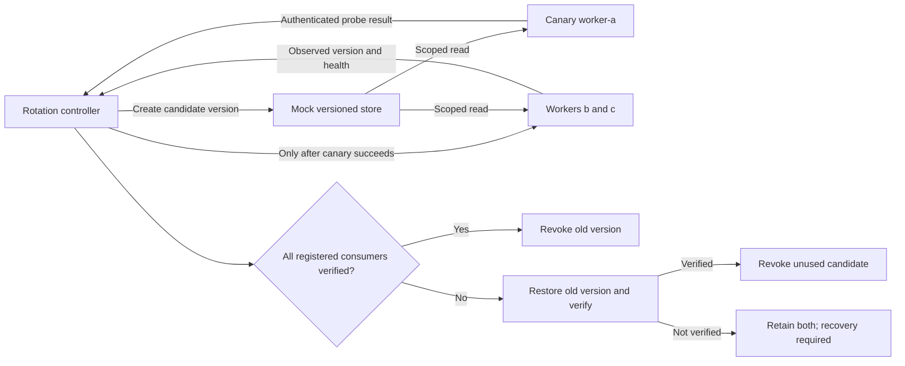

# Secrets Rollout Lab

A small, runnable architecture POC for one question: **when is it safe to revoke an old credential after creating its replacement?**

This is an AI-assisted, entirely synthetic portfolio prototype. It is a local, in-memory simulation with no network calls, real credentials, employer material or vendor SDK. It does not integrate with Infisical or Vault, or demonstrate production security.

## The customer problem

Creating a new secret does not prove that every application is using it. A slow restart, stale cache or failed deployment can leave some consumers on the old version. Revoking that version too early can cause an outage. Keeping it indefinitely defeats the purpose of rotation.

The lab separates **configured version** from **observed version**. It verifies a canary first, promotes the remaining registered consumers, and gates revocation on successful verification. If promotion fails, it restores the previous version. If rollback cannot be verified, it retains both versions and reports that recovery is required.

The intended stakeholders are application owners, platform teams and security reviewers. They get a concrete adoption check and a recovery decision, rather than a successful configuration update being treated as a successful rollout.

## Architecture



The mock store also models the upstream system's acceptance of credentials. In a real integration those are separate responsibilities: making a secret unreadable in a manager does not necessarily invalidate it at the database or API that accepts it.

## Run it in five minutes

Requires Python 3.10 or later. No packages or account setup are needed. Run from this repository's directory.

```bash
python3 -m unittest -v
python3 lab.py --scenario happy
python3 lab.py --scenario canary-failure
python3 lab.py --scenario consumer-failure
python3 lab.py --scenario rollback-failure
```

Failure demonstrations intentionally return nonzero exit codes. Run the commands individually, not as a shell chain that stops on the first failure.

| Scenario | Result | Active versions | Exit code |
| --- | --- | --- | --- |
| `happy` | `ROTATED` | `v2` | 0 |
| `canary-failure` | `SAFE_ROLLBACK` | `v1` | 2 |
| `consumer-failure` | `SAFE_ROLLBACK` | `v1` | 2 |
| `rollback-failure` | `RECOVERY_REQUIRED` | `v1`, `v2` | 3 |

To save a report:

```bash
python3 lab.py --scenario happy --output reports/happy.json
```

Each report contains ordered events, version identifiers and service health. It excludes the mock secret values. The committed [example reports](examples/) are generated by the CLI and are deterministic.

The GitHub Actions workflow is configured to run tests on Python 3.10 and 3.13, following the [official Python workflow pattern](https://docs.github.com/en/actions/tutorials/build-and-test-code/python). Local tests passed. See the repository's Actions tab for hosted workflow results.

## What to inspect

1. In the happy report, all three `consumer_verified` events precede revocation of `v1`.
2. In the canary failure report, no remaining consumer receives `v2`.
3. In the downstream failure report, the previously verified canary is restored to `v1` along with the other consumers.
4. In the rollback failure report, no version is revoked. A failed recovery is visible rather than being labeled a successful rollback.
5. Tests show a reader cannot create or revoke versions, another path does not expose this path's versions, and desired configuration alone cannot pass the retirement gate.

## Implementation decisions

| Decision | Reason | Cost or boundary |
| --- | --- | --- |
| Separate desired and observed versions | Configuration delivery is not adoption | Requires a meaningful application probe |
| Keep both credentials valid during promotion | Allows gradual adoption and rollback | Extends the interval in which both credentials work |
| Canary before remaining rollout | Limits initial exposure to one consumer | One canary cannot represent every workload |
| Recheck the full declared inventory on rollback | Untouched consumers also need to remain usable | Depends on complete consumer discovery |
| Reader scopes differ from controller privileges | Models separation of responsibilities | ACL enforcement is trusted local Python, not authenticated identities |
| Retain versions when recovery is unverified | Avoids deleting an unknown consumer's only working credential | Needs time-bounded escalation in a real system |

## What this POC proves and does not prove

The 11 tests exercise the modeled sequence, access decisions, revocation gate, missing-secret handling and failure responses. They do **not** establish zero downtime, real throughput, resistance to attackers, secure secret storage or distributed correctness.

The implementation is deliberately synchronous and single process. It has no concurrency control, persistence, retries, network faults, cryptographic storage, real authentication or crash recovery. Any Python caller can alter in-memory state. Reports cover only three explicitly registered mock consumers. A passing test cannot establish that a real fleet has no unknown consumers or stale credential caches.

Before a real pilot, add provider adapters, an authoritative consumer inventory, application-specific authenticated probes, durable rollout state, concurrent-rotation protection, retry and timeout rules, a bounded overlap policy, provider rate-limit handling, and an independently tested revocation operation. Long-lived connections and version-specific permissions need explicit treatment. See [POC.md](POC.md) for discovery questions and acceptance criteria.

## How I would present this in a technical evaluation

Start with the customer's outage risk, walk through one failed canary, and explain why successful secret retrieval is insufficient evidence of successful adoption. Then ask what the customer's actual credential issuer, deployment controller and consumer inventory are. Those answers determine the integration design.

This prototype supports a discussion about discovery, architecture and validation. It should be described as a synthetic lab, not as a deployed customer implementation.

## Files

- `lab.py`: mock store, consumers, rollout controller and CLI.
- `test_lab.py`: behavioral acceptance tests.
- `examples/`: deterministic reports from all four scenarios.
- `POC.md`: evaluation scope, criteria and production follow-up.
- `.gitignore`: excludes local environment files, caches and generated reports.
